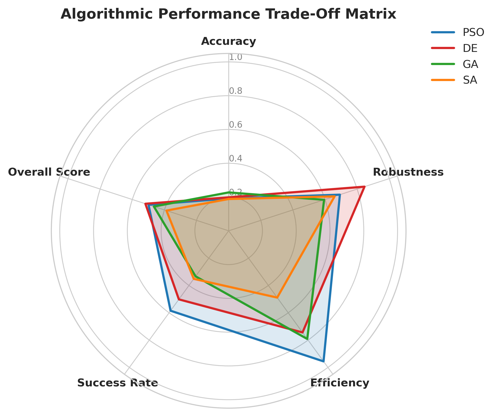
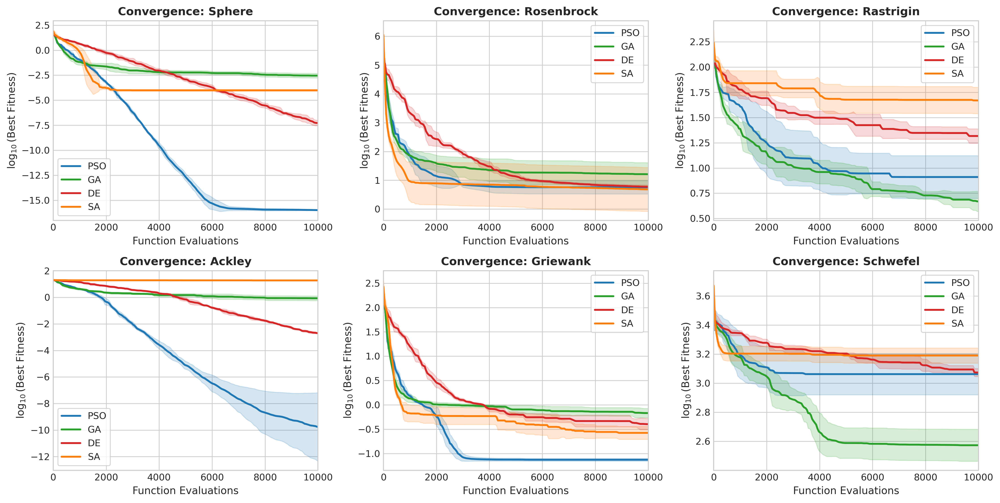
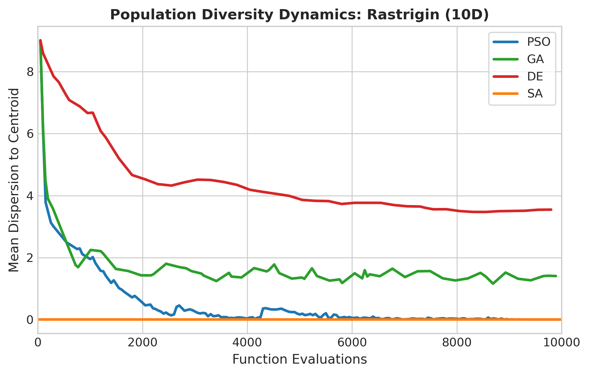
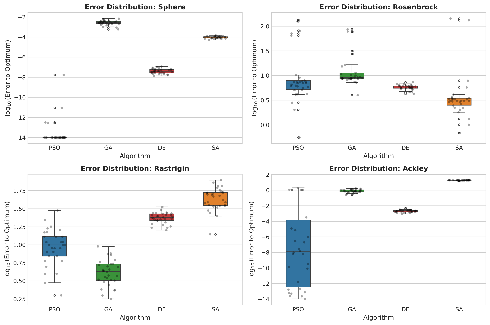
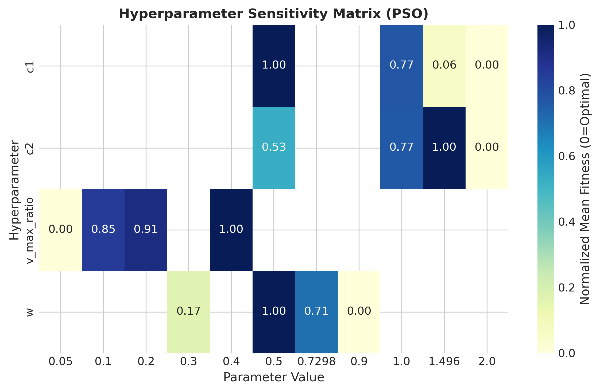
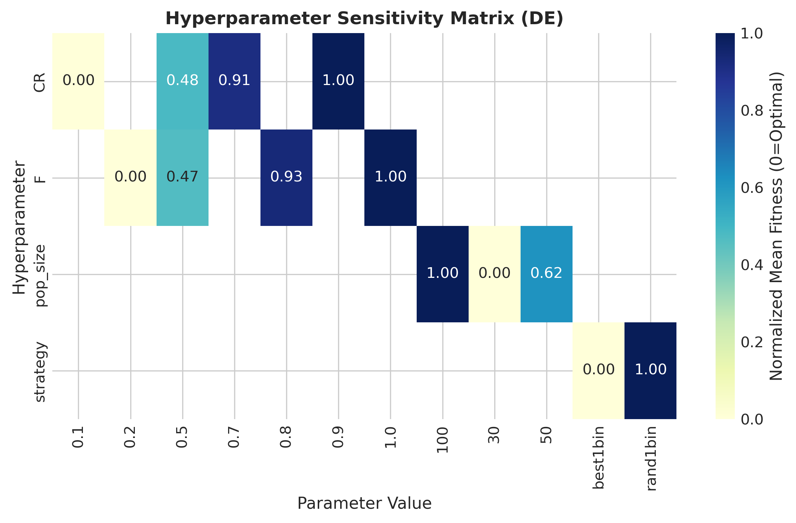

# MetaBench: Rigorous Metaheuristic Optimization Framework

A high-performance, modular Python benchmarking suite for metaheuristic optimization algorithms across diverse continuous fitness landscapes.



---

## 🌟 Highlights & Features

- **4 Core Metaheuristic Algorithms**:
  - **Particle Swarm Optimization (PSO)**: Global-best topology with inertia weight damping.
  - **Real-Coded Genetic Algorithm (GA)**: Tournament selection, arithmetic blend crossover, Gaussian mutation, and elitism preservation.
  - **Differential Evolution (DE)**: Binomial crossover with `rand/1/bin` and `best/1/bin` strategies.
  - **Continuous Simulated Annealing (SA)**: Adaptive temperature-proportional step scaling and Metropolis acceptance criterion with stagnation reheat.

- **20 Continuous Benchmark Topologies**:
  - **Unimodal**: Sphere, Sum of Squares, Zakharov, Dixon-Price.
  - **Multimodal**: Rastrigin, Ackley, Griewank, Schwefel, Levy, Michalewicz, Cross-in-Tray, Holder Table, Schaffer N.2, Shubert.
  - **Valley-shaped**: Rosenbrock, Beale, Bukin N.6, Trid.
  - **Plate-shaped**: Booth, Matyas.
  - Automatic handling of scalable (arbitrary dimension up to 100D+) and fixed 2D topologies.

- **Strict Budget Enforcement & Telemetry**:
  - Unyielding evaluation count limits via `OptimizationProblem`.
  - Step-by-step trajectory tracking: population diversity, step velocities, and convergence trajectories.

- **Rigorous Statistical Analysis**:
  - Non-parametric hypothesis testing: **Friedman Ranking** and **Wilcoxon Signed-Rank Tests**.
  - Robustness Index, Success Rate, and Multi-Objective Composite Scoring.
  - One-At-A-Time (OAT) Hyperparameter Sensitivity sweeps with Morris screening foundations.

- **Publication-Ready Visualizations**:
  - Multi-dimensional radar charts for algorithmic trade-offs.
  - Convergence comparison curves with variance bands.
  - Error distribution boxplots.
  - Population diversity dynamics over time.
  - Parameter sensitivity heatmaps.

---

## 📁 Repository Structure

```text
MetaBench/
├── metabench/
│   ├── algorithms.py              # PSO, GA, DE, SA implementations
│   ├── benchmarks.py              # 20 continuous benchmark topologies
│   ├── framework.py               # OptimizationProblem and BaseMetaheuristic
│   ├── benchmark_runner.py        # Parallel trial execution & campaign orchestration
│   ├── trajectory_tracker.py      # Population diversity & telemetry history
│   ├── convergence_analysis.py    # Convergence rates, AUC, stagnation analysis
│   ├── statistical_metrics.py     # Friedman ranking, Wilcoxon tests, trial stats
│   ├── metrics.py                 # Robustness index, success rates, composite score
│   ├── parameter_sensitivity.py   # OAT parameter sensitivity sweeps
│   ├── hyperparameter_config.py   # Preset configurations and parameter grids
│   ├── results_analyzer.py        # Automated report generation & trade-off matrices
│   └── visuals.py                 # Matplotlib & Seaborn visualization suite
├── tests/                         # Pytest test suite (40+ unit tests)
├── figures/                       # Generated publication figures
├── results/                       # Exported benchmark CSV datasets
├── run_experiments.py             # Main CLI experiment runner
├── requirements.txt               # Dependencies
└── README.md                      # Project documentation
```

---

## 🚀 Getting Started

### 1. Installation

Clone the repository and install the dependencies:

```bash
git clone https://github.com/sharvarikolte576/MetaBench-Metaheuristic-Optimization-.git
cd MetaBench-Metaheuristic-Optimization-
pip install -r requirements.txt
```

### 2. Run Quick Demo

Execute a fast demonstration across 4 algorithms and 4 key landscape topologies:

```bash
python run_experiments.py --quick-demo
```

### 3. Run Full Benchmark Campaign

Run the full benchmark campaign (4 algorithms × 20 benchmarks × 30 seeds = 2,400 trials):

```bash
python run_experiments.py --full-benchmark --workers 4
```

Custom campaign example:

```bash
python run_experiments.py --full-benchmark --workers 8 --budget 5000 --seeds 10
```

### 4. Run Hyperparameter Sensitivity Analysis

```bash
python run_experiments.py --sensitivity
```

### 5. Run Unit Tests

Verify algorithm correctness and test coverage using `pytest`:

```bash
pytest tests/
```

---

## 📊 Benchmark Figures

| Radar Trade-Off Chart | Convergence Comparison |
| :---: | :---: |
|  |  |

| Diversity Dynamics | Error Boxplots |
| :---: | :---: |
|  |  |

| PSO Sensitivity Heatmap | DE Sensitivity Heatmap |
| :---: | :---: |
|  |  |

---

## 📜 License

MIT License. Feel free to use and extend for academic and research purposes.
